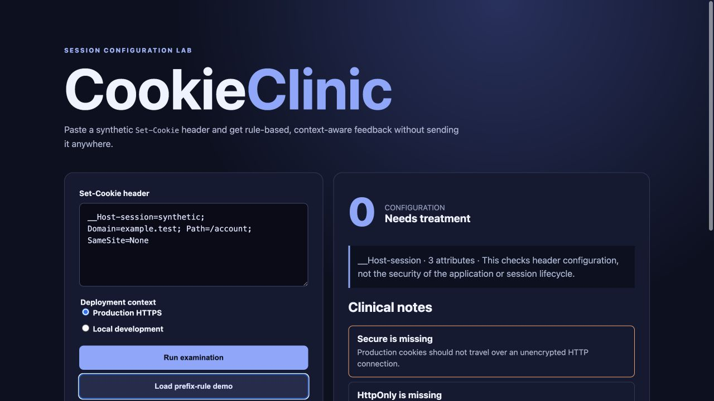

# CookieClinic

CookieClinic is an interactive, local lab for examining one synthetic
`Set-Cookie` header at a time. It explains `Secure`, `HttpOnly`, `SameSite`,
scope, and the exact `__Host-`/`__Secure-` prefix rules in production or local
development context.

Open `index.html` or run `npm test` with Node 20+.

The score is a teaching and review aid. It cannot evaluate server-side session
rotation, token quality, cross-site scripting, logout invalidation, browser
support, or the rest of an application's threat model. Do not paste a real
session value; replace it with a synthetic placeholder first.

## AI-assisted authorship

OpenAI Codex generated the initial implementation, tests, interface, and
documentation. The owner must review and understand it before describing a
personal contribution.
